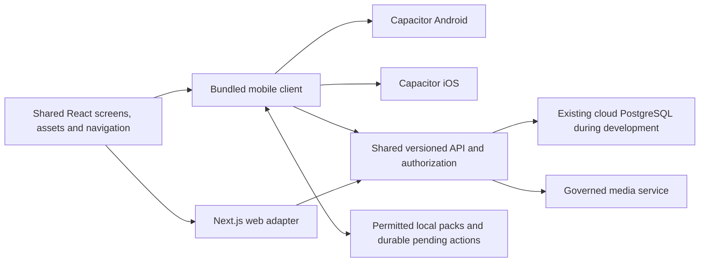

# Luo Heritage Phase Two delivery plan

> Latest development increment, 14 October 2026: protected native storage, rotating renewal and offline sign-out retry are implemented. See [the session implementation and limits](PHASE_TWO_NATIVE_SESSION_RENEWAL.md) and the dated verification entry at the end of this plan.

Updated 12 October 2026 after the project owner's scope decisions. See [the evidence review](PHASE_TWO_SCOPE_REVIEW.md) for document/data findings and the full PRD module comparison.

For the plain-language done/remaining lists, technology setup status and starting order, use [PHASE_STATUS_AND_COMPLETION_CHECKLIST.md](PHASE_STATUS_AND_COMPLETION_CHECKLIST.md).

## Confirmed decisions

- Retain the complete PRD/NRF scope and extend the original three-day deadline.
- Use the existing cloud database for development/testing and preserve every existing record. No reset or reseeding. Use backups, additive migrations and migration checks before applying schema changes.
- Defer JOOUST server migration to a later milestone. Cloud development does not establish final compliance with the formal on-premises acceptance requirements.
- Web, Android and iOS must use the same application identity, account records, content, permission rules, screen designs, navigation destinations, button labels and feature behavior. Layout responds to screen size; OS permission dialogs and system navigation follow each platform.
- Neither Google Play nor Apple organization account is ready. Begin institutional enrollment/verification while implementation proceeds, using [STORE_ACCOUNT_SETUP.md](STORE_ACCOUNT_SETUP.md).

## Architecture direction for the same interface

Use shared React presentation components and design assets, with a bundled browser client for Android/iOS through Capacitor and an adapter for the Next.js web host. Keep server-rendered pages/backend services in Next.js where appropriate. Client-only screens consume versioned APIs; shared components depend on narrow routing, session, media and persistence interfaces rather than importing platform services directly.

This direction replaces the earlier preference for a separate React Native screen implementation because the user now explicitly requires interface reuse. Validate it with bundled-screen, native-auth and offline technical proofs before committing to the complete native build architecture. Capacitor packages and a development configuration are included in clients/mobile; separate Android/iOS platform projects are now generated; native compilation, signing and device acceptance remain pending. Do not treat a remote URL wrapper, a blank native shell or a scaffold as a completed mobile app.

The current server-rendered web pages cannot be copied unchanged into a static offline bundle. Extract shared presentation progressively, retain regression checks for the existing web journeys, and verify account/session behavior across native and browser environments. Public configuration does not grant administrative access; all protected operations remain authorized server-side.

## Milestones and acceptance

| Milestone | Work | Exit evidence |
|---|---|---|
| 1. Shared foundation | Common navigation/filter definitions, versioned bootstrap DTO, application/platform adapters, packaged-screen proof, store enrollment guide | Matching navigation contract, schema tests, no private bootstrap fields, current web checks, static bundle proof and named unresolved native-tool/signing dependencies |
| 2. Identity and governance | Native OAuth/session lifecycle, recovery/verification, self-deletion, MFA/SSO design, account-role parity, source consent/collective rules and protected identity design | Authentication/revocation/recovery tests, mobile role checks and governed consent cases |
| 3. Content and complete learning | Fifteen-module requirements implemented in agreed increments: reviewed library content, lessons/quizzes/progress/saves, calendar, audiovisual/research workflows, tutor/gamification | Per-module acceptance with approved data; same buttons and results on web/native clients |
| 4. Offline/native workflows | Pack eligibility, local storage/search/playback, durable sync/idempotency/conflicts, camera/audio/upload, permissions and weak-network behavior | Airplane-mode/restart tests, interrupted-transfer recovery and cross-device progress checks |
| 5. Communications and AI | Push/email/optional SMS delivery, grounded answers, translation/speech/vision/OCR/tutor pilots, quality/spend/deadline controls and provider boundaries | Real-device/service results and expert-evaluated data/model reports; experimental features do not claim dependable accuracy without evidence |
| 6. Full research and immersive scope | Repository relationships/releases/withdrawal/index/model lineage, research exports, full games and scoped 3D/animation/tours, approved multilingual content | PRD feature matrix and formal repository acceptance evidence, including source rights and provenance |
| 7. University migration and operational acceptance | Later JOOUST-local storage/DB/search/inference/backup migration, schedules/fixity/recovery, capacity/security tests and rollback | Witnessed restores, authorization tests, on-premises isolation test, ICT/custodian sign-off |
| 8. Native release and support | Signed AAB/IPA, Play test tracks/TestFlight, store policies/listings/reviewer access, real-device QA, staged rollout and handover | Recorded submission/review outcomes, release monitoring and institution-owned signing/source/operations handover |

These milestones retain the full scope. Calendar estimates must follow the foundation/auth/offline proofs and availability of approved content, recording rights, validated translations, store accounts, devices and ICT support. The earlier fifteen-week proposal describes a narrower scope; it is not a guaranteed estimate for every PRD/NRF feature. Store verification/review cannot be scheduled as a coding task or guaranteed inside three days.

## Current implementation status

- Existing: phase-one web/backend and the prior tested workflows described in the evidence review.
- Implemented in this milestone: framework-independent navigation/filter/view definitions, typed public bootstrap/library DTOs and GET /api/v1/bootstrap plus /api/v1/library. The library shares its query service with the web dashboard and preserves record/media public-consent filters. Responses select presentation fields, omit identities/internal metadata and use no-store. Public CORS allows explicit native origins and configured development origins without credentialed access.
- Extracted reusable overview, sidebar and content presentation components. The clients/mobile development preview bundles these actual web components, design CSS/local fonts and the same icon. Unbundled sign-in/contribution/chatbot destinations currently open the web host; this preview is not full feature parity. See [the preview instructions](clients/mobile/README.md).
- Native projects now exist in clients/mobile/android and clients/mobile/ios and receive the same built screens. Native launcher/splash artwork is exported from the shared SVG. See [SHARED_APP_ARCHITECTURE.md](SHARED_APP_ARCHITECTURE.md) for folder ownership and one-database/account/history rules.
- Added a shared typed API client, a protected account DTO/API and shared chat-history query/API used by the existing web chatbot and versioned API. A subsequent increment adds a system-browser/PKCE native sign-in bridge with short-lived device sessions and shared account/history screens; see [the detailed scope](PHASE_TWO_NATIVE_SIGN_IN.md).
- Not yet complete: native compilation/signing/device acceptance, persistent secure sessions/refresh, media/persistence adapters, new learning/offline modules, complete advanced PRD features and final NRF acceptance work.
- External dependency: both store accounts are awaiting institution-owned enrollment/verification; native signing and real-device access are not established here.

No database schema or content change is required by this configuration/library/presentation increment. The existing records are preserved. Record verification results with each implementation milestone; do not replace the status list with a completion claim until the relevant behavior is tested.

## Foundation verification, 12 October 2026

- Root TypeScript check passed. All 54 automated regression tests passed, including shared navigation, published record/media restrictions, bounded public projections, unavailable modules, maintenance, explicit CORS and existing authorization/workflow tests.
- Production Next.js build passed. Lint reports 28 existing image-optimization warnings and no errors; the shared content screen retains the previous image behavior. Existing web browser checks passed for structured contributions, required-field validation without submission, public/admin/super-admin switching, dictionary navigation and Inter/Lora loading.
- The isolated mobile TypeScript/Vite production bundle passed. It contains the icon plus all fourteen local font files. Its main JavaScript is approximately 67 kB gzip and CSS approximately 14 kB gzip for this initial library proof; these are bundle sizes, not claims about complete app download size or runtime speed.
- Read-only Chrome checks against the real backend passed for the mobile preview's live overview/library, desktop sidebar collapse/expand, feed/grid controls, language change, mobile drawer/navigation, no horizontal overflow and failed-network retry/recovery. No app exceptions were observed in these checks. They do not demonstrate real Android/iPhone behavior or signing.
- Public API checks returned 200 with no-store and the explicit Capacitor origin. The artifact library returned one published record; the oral-history library returned zero records, preserving the research-only boundary. Example sequential local API timings were about 1.25 seconds for bootstrap, 3.90 seconds for artifacts and 1.41 seconds for oral histories. Existing web browser transitions ranged from about 1.1 to 6.9 seconds in this run; cloud/network/query performance still needs work and these measurements do not establish the formal NRF load targets.
- No database writes, schema migrations, reseeding, production deployment, store registration or signing was performed for this milestone.

The initial foundation priority was the native authentication/session proof. That bridge is now implemented as described in the latest increment; native-device/HTTPS validation and secure persistent sessions remain, followed by recovery/deletion and governance. The full PRD/NRF milestones above remain in scope. This foundation is not a completed Phase Two release.

Commit message for this increment: `feat: add shared web and mobile foundation with governed library APIs`

## Separate-platform and shared-account increment, 12 October 2026

Separate Android/iOS source projects were generated with Capacitor 8.5.3. The mobile build and synchronization to both platforms passed; generated bundles are ignored by Git. Sixty automated regression tests and the root TypeScript check passed. Account tests cover stable existing identity, fresh permissions, account status, private fields, owner-only chat history, web/versioned query parity and protected API boundaries. No schema or database record was changed.

The environment check found Node/shared bundles/projects/backend ready, with Java/Android SDK/ADB, a Mac/Xcode environment and an HTTPS native-distribution backend configuration pending. These missing prerequisites prevent a claim of completed native compilation/device testing. Native login and progress/offline synchronization remain development tasks.

Final verification for this increment: the production Next.js build passed with 28 existing image warnings and no errors. The mobile-browser navigation/language/view/network-recovery check passed after adopting the shared API client. Read-only live checks for two existing accounts confirmed stable identity and matching saved-chat history between the legacy web and versioned endpoints; anonymous history access was rejected. Both native directories contain byte-identical copies of all eighteen shared bundle assets, and the iOS launcher icon is opaque 1024×1024. No APK/IPA compilation, native sign-in, device acceptance, production deployment or database change is claimed.

Commit message: `feat: add separate native projects and shared account history APIs`

## Native sign-in and account-screen increment, 12 October 2026

Added a system-browser login/approval flow, state-bound SHA-256 PKCE, short-lived single-use authorization codes, hashed ten-minute device sessions and per-device revocation using existing authentication tables. Exact account/history routes now authorize browser cookies or native bearer sessions in their handlers. Permissions are refreshed from the active central user; a rejected bearer cannot fall back to a browser identity. Explicit native-origin preflight does not enable credentialed-cookie CORS. Web and bundled clients share the account/history screen, including Recent/Archived filters and retry. Official App/Browser plugins and callback registration are included in both platforms.

The complete regression suite passed all 74 tests. Root TypeScript and script syntax checks passed; lint has 28 existing image warnings and no errors. The web production build passed after marking the private admin layout force-dynamic: the earlier build had attempted database queries while prerendering the new-language page and failed during an intermittent cloud connection timeout. The mobile production build and native synchronization passed with both official plugins, and all twenty shared bundle files were verified byte-identical in both native projects.

Final read-only live checks on the new local production server passed for two existing accounts: stable user IDs, matching legacy/versioned saved-chat history, the shared account page, explicit native preflight, rejected invalid-bearer fallback and anonymous denial. The final mobile browser check passed navigation, content/views/language, sidebar collapse/drawer, account sign-in boundary/correct selection, no overflow and network-error retry. Earlier attempts timed out during concurrent builds/setup and cloud-connection failures; the successful rerun does not establish NRF load/performance targets. No real native sign-in, signed APK/IPA or production deployment is claimed.

Local review uses the successful `.next-phase-two-auth` build on localhost:3000. Normal `npm run build`/`npm start` still use `.next-review`; rebuild from current source before a later ordinary restart. The validation output is ignored by Git/Vercel. Npm's previous 3.38 GB C: package cache was preserved on D: and future user-level npm caching points to D:, recovering about 3.39 GB on C:. No project/personal/database files were removed by this cache relocation.

Tests use mocked database services; no real accounts, research records, conversations or schema were changed. Live native sign-in will create only its required temporary authentication rows. HTTPS deployment and actual Android/iPhone callback acceptance, protected persistent storage/refresh, recovery/deletion/MFA/SSO and full shared screen/role parity remain pending. Details and configuration are in [PHASE_TWO_NATIVE_SIGN_IN.md](PHASE_TWO_NATIVE_SIGN_IN.md). Neither a compiled APK/IPA nor completion of the identity milestone is claimed.

Commit message: `feat: add PKCE native sign-in and shared account history screens`

## Shared chat and native build preparation, 12 October 2026

The web and bundled mobile client now use one shared chat component and versioned owner-scoped message/actions APIs. Account history opens the selected conversation. Implemented earlier-message paging, rename/pin/archive/delete, explicit Google AI-processing permission, active-account checks, fresh server-owned conversation context, guarded browser/native origin rules and failure/retry states. Legacy web APIs delegate to the same services. Provider failure creates no empty conversation; successful new chats and answers are saved together transactionally. Concurrency checks prevent an archived/deleted chat from accepting an answer. Only public navigation metadata is reused briefly in memory; content and personal data stay fresh.

The final complete regression suite passed **88 tests**. The production web build passed, including type validation; lint has 28 existing image warnings and no errors. The final shared mobile production build and synchronization passed; all twenty bundled files matched byte-for-byte in Android and iOS. The Chrome check passed real public-library/navigation/network recovery and the actual shared chat permission/failure/retry/source-link/history-limit/mobile-layout flow. AI requests in the browser proof were intercepted: no provider charge, live quota mutation or test conversation was created.

Development build commands and a manual Android/macOS CI workflow are prepared and syntax/YAML-checked. They have not produced a native APK/IPA or run on GitHub. Local SDK API 36 is still absent in the latest inspection; the installed API 37 does not replace the project's compile SDK. Windows cannot execute the iOS build locally. The workflow requires the current backend deployed at a reachable HTTPS origin, root/shared and mobile dependencies, Android SDK/Java or macOS/Xcode. Store release/signing remains explicitly gated pending institution-owned identifiers and signing/device acceptance.

The newly successful ordinary `.next-review` production build now runs at localhost:3000, replacing the previous local review server. No web production deployment, database schema/data change, trained model, persistent native login, complete mobile role/contribution parity, offline/curriculum/push or complete PRD/NRF delivery is claimed. The remaining full scope is retained in [the completion checklist](PHASE_STATUS_AND_COMPLETION_CHECKLIST.md), with [shared chat limits](PHASE_TWO_SHARED_CHAT.md) and [configuration locations](PHASE_TWO_CONFIGURATION_GUIDE.md).

Read-only live checks against that new local server passed for two existing accounts: stable identity, matching legacy/versioned history, shared account/chat HTML, native preflight, rejected bearer fallback and anonymous denial. One existing saved conversation was available for an additional byte-equivalent legacy/versioned message comparison and anonymous-detail rejection. These checks did not modify records or print personal data; live provider generation and real device sign-in remain untested.

Commit message: `feat: share chat across web and mobile with native build workflows`

## First Android APK and USB setup, 12 October 2026

Android Studio setup finished, and actual checks confirmed API 36, Build-Tools 36.0.0, Platform-Tools, Command-line Tools and the API 37 emulator image installed on D:. WHPX acceleration is usable. Java 21 is configured separately from the IDE JBR. A real Android 10 phone was connected and authorized; its active WebView is recent.

The Gradle wrapper now uses the smaller official 8.14.3 binary archive with its published SHA256 pinned. The first download was very slow; checked parallel ranges of that same official archive were assembled and verified against the official hash before use. Dependencies/caches remain on D:. No reference/research files were deleted. Compilation additionally installed the AGP-requested Build-Tools 35 package using already accepted licenses.

`assembleDebug` generated an approximately 5 MB development APK. The initial lint run identified a Windows property escaping error, which was corrected in ignored local SDK/JDK configuration files. Manifest order and explicit Android backup/transfer exclusions were also corrected. The final Gradle run of `assembleDebug`, `lintDebug` and `processReleaseMainManifest` passed: **zero lint errors and 27 warnings**. Remaining warnings principally concern template assets and available dependency updates; no lint baseline or error suppression was added. The merged debug manifest includes localhost-only HTTP configuration, while the merged release manifest excludes it. Both include the backup exclusions. Actual Android 12+ backup/transfer behavior remains a later device-acceptance check.

The generated APK's signature verified, and it installed/launched successfully on the user's selected USB phone under the development identifier. The WebView loaded the public overview and header artwork. Visible layout/navigation assertions could not complete because the phone went to sleep and reported a zero-width hidden viewport; the phone has been requested to remain unlocked with the app visible. No native visual/device acceptance pass is claimed from background rendering.

Local backend startup repeatedly failed its database connection window during setup. A fresh read-only query confirmed the database was reachable. Testing thirty-second connection/pool timeouts restored bootstrap responses, and those parameters were saved in the ignored local environment file while validating unchanged database identity, credentials and all other settings. Cold/warm measured responses during this loaded setup session were still slow (roughly 16 and 6 seconds); this is an availability improvement, not NRF performance acceptance. Existing database/research records were not modified.

Added explicit `build:android:usb` readiness/build support, localhost-only debug networking, the read-only native WebView smoke helper and [ANDROID_USB_TESTING.md](ANDROID_USB_TESTING.md). The local Android/backend readiness check passed. Native sign-in still requires a reachable HTTPS deployment of the new APIs; persistent login, native account acceptance, signed store releases, iOS compilation and the full remaining PRD/NRF scope remain open. This APK is a development prototype, not a Google Play release.

Commit message: `build: validate Android APK and enable USB library testing`

## Visible Android checks and mobile header fix, 12 October 2026

The unlocked Android 10 phone exposed a real small-screen header defect: the layout fitted its 360-pixel viewport, but the app-name element had zero width. Chat and Language now move to a second row on small screens, while desktop retains one row. The updated phone header has 154 pixels available for the app name and no horizontal overflow.

Mobile library/account reads now wait at most forty seconds rather than twenty, allowing the backend's thirty-second database connection window to return a result or error. Navigation still cancels outstanding reads, and errors retain the retry control. This is a bounded timeout correction, not NRF speed acceptance. Separately, older local server/cloud connections reset after the native build while a fresh read-only connection succeeded. Restarting the local review server restored reads; cloud connection stability and long-idle recovery remain unresolved. Measured library responses in this session were approximately twenty seconds cold and seven seconds warm.

USB reverse forwarding also disappeared during the setup/build session. Restoring the localhost mapping made the phone able to reach the laptop again. The native smoke helper now fails immediately for a missing mapping, collects only public endpoint/status diagnostics, and restores networking and the overview after checks. It never prints device identifiers or personal history.

The updated shared mobile production build, Android readiness check, debug compilation and Android lint passed (**zero errors, 27 warnings**). The APK signature verified; the update installed over the existing app and only Luo Heritage was restarted. All twenty bundled files match between Android and iOS. The desktop/narrow-screen browser proof passed again, including the 360-pixel visible-name assertion and intercepted chat tests. No iOS compilation is claimed by asset synchronization.

The final actual-phone smoke passed visible icon/name/overview, governed live library, sidebar navigation and closure, language and view controls, screen fit, simulated lost-connection retry, the bundled chat processing-permission boundary and the signed-out saved-chat boundary. No live AI request, account/content mutation or research record write was made. These passes used the restarted local backend and restored USB forwarding; they do not prove sustained cloud availability or the complete PRD/NRF scope.

Next implementation/acceptance work remains database reliability and speed, current API deployment at a reachable HTTPS origin, actual native sign-in/history/roles, persistent protected sessions, the unfinished shared screens and PRD/NRF features, plus Mac/iPhone builds and signed releases. Store accounts/credentials alone do not complete those tasks.

Commit message: `fix: improve mobile header layout and connection recovery checks`

## Android USB login and registration return paths, 12 October 2026

The reported Sign in failure came from the installed USB development APK's HTTP backend being rejected by the native sign-in coordinator. Added an explicit Android USB debug mode controlled by compiled `DEBUG` and `USB_AUTH_ENABLED` constants, with an additional client restriction to localhost/127.0.0.1 on port 3000. The build command supplies `-PluoUsbAuth=true` only for `build:android:usb`. Ordinary builds retain the HTTPS requirement. The release Java code was compiled with the same project property, and both its generated configuration and compiled bridge bytecode were verified to keep USB authentication disabled. No frontend environment setting can turn it on in a release build. This is local HTTP development testing, not an HTTPS deployment or store release.

Sign in and Create account now open the existing web forms in the system browser. Registration/login links, successful password registration, pending registration/sign-in failures, Google rejection and Google profile completion retain the strictly validated native approval destination. The OAuth continuation cookie contains only public return/challenge context and expires after ten minutes; device verifiers and tokens remain in memory. PKCE/state/single-use-code, browser approval, active-account/role checks and owner-only history remain enforced. Credential auto-login failures after successful registration now expose the usable login destination. Normal web role destinations are preserved.

The phone header has a separate Create account control and keeps Sign in on one line. Connection/build errors use user-facing messages and a dismiss control instead of exposing `VITE_API_ORIGIN` configuration instructions. Availability is checked before opening the browser; authorization/exchange waits allow the backend connection window to complete while remaining bounded.

Verification passed: **92 mocked regression tests**, production web build including types, shared mobile production build/synchronization and all twenty bundle files identical between Android/iOS. Web lint has zero errors/28 existing image warnings. Android debug compilation, lint and release Java compilation passed; Android lint has zero errors/27 warnings. The APK signature verified and the update installed over the existing app. The complete visible Android public-library/navigation/layout/retry and signed-out chat/account smoke passed again. The WebView smoke now waits for its own inspection socket after a cold launch rather than reporting a premature startup failure.

The real web-form browser proof passed Login → Create account → Sign in return-context preservation, rejected external callback destinations and 360-pixel layout. The actual installed phone's Sign in button opened the existing web login form; the native debug gate was enabled and the phone form fitted its viewport. The phone browser was left open for the user to enter credentials and select Continue to app. Automated checks read/submitted no password, created no account or authorization grant, and changed no research/history records. Manual authenticated return/account/history acceptance is awaiting the user's result and must be recorded separately; opening a form is not a successful sign-in claim.

No cloud deployment, store publication or iOS compilation was performed. Distributed HTTPS login, complete identity/session storage/refresh, Google provider acceptance, account recovery/deletion/MFA and the other document requirements remain open. See [the native sign-in notes](PHASE_TWO_NATIVE_SIGN_IN.md) and [USB testing steps](ANDROID_USB_TESTING.md).

Commit message: `fix: enable Android USB sign-in and preserve registration return paths`

## Protected native storage and session renewal, 14 October 2026

Resumed from the browser-login proof. The shared native coordinator now persists pending PKCE and origin-bound session state through platform-protected storage, renews short access sessions and retries pending sign-out requests after reconnection. Android has an AES-256-GCM/Keystore plugin; iOS has a non-synchronizing, device-only Keychain plugin and an installation marker. Both iOS launch paths now register the storage plugin through the same controller. Session writes are serialized, simultaneous reads share renewal, and a late exchange/renewal response cannot undo sign-out. Same-account renewal keeps the current chat screen rather than remounting it.

The backend uses the existing authentication tables for hashed access/renewal credentials, thirty-day absolute families, atomic rotation, used-token replay detection and per-family revocation. Access cannot extend beyond that family's expiry. The exact refresh endpoint is delegated through middleware to its bearer-proof handler; no cookie fallback or caller-supplied user/role is accepted. Existing account status/role and own-history rules remain in place. The legacy access-only shape remains accepted for the preceding proof.

Verification passed: **108 isolated regression tests**, root TypeScript checks, the final production web build, shared mobile production build and Android/iOS asset synchronization. All **twenty** shared bundle files match byte-for-byte across both native projects. Full web lint has zero errors/28 existing image warnings; targeted checks for the new identity code and device helpers also passed. Android Java compilation, debug APK packaging and lint passed; the signed debug APK passed signature verification. Android lint reports zero errors/29 warnings, including two recommendations to replace synchronous preference cleanup with asynchronous `apply()`; login-state operations intentionally commit their small encrypted state before continuing the authorization flow.

The final local production server was started on loopback port 3000. Live read-only checks passed public bootstrap, exact renewal-route reachability, malformed payload rejection, unknown dummy renewal-token rejection, no-store private responses, denied unrelated-origin preflight, anonymous-account denial and protection of neighboring routes. No real session, authorization grant, account or research record was created by these checks. There was no reset, schema migration, reseeding or cloud deployment.

**Phone acceptance is pending.** The USB phone was initially authorised, then ADB lost it during compilation. Installation attempts stopped before writing the APK because the phone was unavailable. Windows detects an Android USB interface, but restarting/reconnecting ADB still reported offline/no device. The protected-storage primitive check and the actual sign-in → browser approval → app return → account/history → restart → renewal → sign-out journey have not passed on the phone in this increment. The new APK is ready at `clients/mobile/android/app/build/outputs/apk/debug/app-debug.apk`; it must be installed after USB debugging recovers. The earlier installed proof is not evidence that this new session implementation passed device acceptance.

The iOS source and bundle are prepared, but no Swift compilation, simulator/device Keychain check, signed release or App Store/Play release was performed. Deployed HTTPS acceptance, device/session management, scheduled expired authentication-row cleanup, full identity features and the complete remaining PRD/NRF work remain open. See [the implementation details and failure limits](PHASE_TWO_NATIVE_SESSION_RENEWAL.md).

Final review also added an account-view generation guard so delayed account/history responses cannot restore an earlier person's screen after sign-out or account switching. Signed-out screens do not render a retained profile/name, and identity changes reset account loading and the archive filter. The mobile bundle was rebuilt for these UI changes. USB recovery still reported an offline device after reauthorization, server restart/reconnection and a trial of Google's documented `ADB_USB_LEGACY=1` option for Platform-Tools 37.0.1. No successful installation or device-storage/login acceptance is claimed.

The built mobile UI's additional headless-browser identity check passed: a fake native bridge restored a fake protected session, account/history requests were deliberately delayed and ignored cancellation, sign-out cleared the UI/state, and their late results did not render private fixture data. This check uses no real credentials or personal API writes and does not replace Android/iOS device acceptance. Run it with the built preview and local backend: `node scripts/smoke-mobile.cjs --identity-boundary`.

The final reconnect adapter retries pending sign-out work on foreground, network-online events and periodic native checks even after the account UI has been cleared. An additional regression covers simultaneous local-storage and network failure: the app clears its in-memory view but accurately reports that durable sign-out could not be saved, so the user must reconnect and retry before closing. This brings the complete mocked regression suite to 108 passing tests.

Commit message: `feat: add protected native login storage and rotating session renewal`
