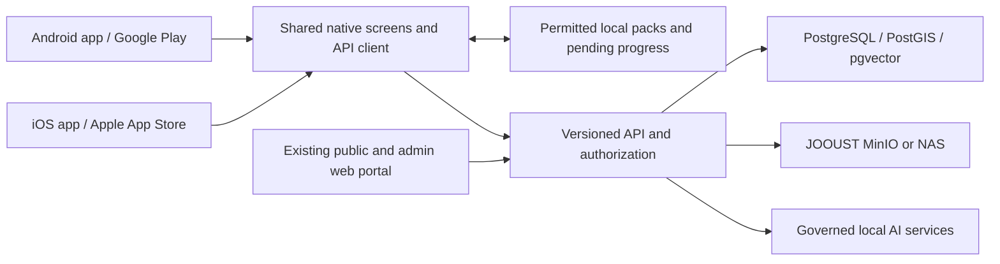

# Luo Heritage: Phase One and Phase Two evidence review

**Reviewed:** 12 October 2026. **Purpose:** define the mobile and repository work needed from the supplied proposals, research archive, current source code, and connected database. This is a scope assessment, not a certification of completion or a new approved contract.

For the current plain-language status, all remaining module work and checked environment setup, see [PHASE_STATUS_AND_COMPLETION_CHECKLIST.md](PHASE_STATUS_AND_COMPLETION_CHECKLIST.md).

## 1. Recommended outcome

**Updated direction, 12 October 2026:** the project owner has retained the complete PRD/NRF scope, extended the deadline, authorized the existing cloud database for development/testing with all records preserved, and deferred JOOUST migration. The requirement now explicitly includes shared interfaces/navigation/buttons across web, Android and iOS. The following evidence findings remain applicable; the earlier React Native recommendation is superseded by the shared-interface architecture proof in [PHASE_TWO_DELIVERY_PLAN.md](PHASE_TWO_DELIVERY_PLAN.md). Store accounts are not ready; see [STORE_ACCOUNT_SETUP.md](STORE_ACCOUNT_SETUP.md).

Build one Luo Heritage mobile product for Android and iOS, distributed through Google Play and Apple's App Store, using the existing accounts, cultural content, permissions, and backend foundation. Keep the web portal for public access and substantial administration. Add genuinely useful mobile learning, permitted offline downloads, reliable synchronization, native recording/upload, notifications, and account recovery/deletion.

Phase Two also includes work on the JOOUST research repository. The formal NRF annexes require more than putting the existing website on a university server: they require local storage and inference, stronger governance, immutable releases, provenance, withdrawal propagation, protected identity information, and witnessed acceptance tests. The mobile release and full NRF repository acceptance should be tracked as distinct deliverables.

The PRD is a draft describing the entire product vision. Its fifteen modules are not evidence that all fifteen are complete, nor that every advanced feature fits the latest fifteen-week mobile proposal. Retain the complete roadmap, but give each deliverable a priority, owner, data dependency, and acceptance test.

## 2. Sources and interpretation

| Source | What it establishes |
|---|---|
| [Phase One funding request](<PHASE ONE AND TWO/Request for  Funding Approval  of LuoLinguaAI Project Phase 1.pdf>) | Web MVP: dictionary, proverbs/riddles, oral history, basic administration, hosting, and NRF-compatible foundations. Six weeks and KES 300,000 are requested for that scope. It identifies future mobile, offline, chatbot, full gamification, and deeper NRF integration. Signature fields do not establish that approval/funding occurred. |
| [Phase One progress report](<PHASE ONE AND TWO/Phase one progress report.pdf>) | Distinguishes an early one-week demonstration from the full six-week phase. Describes substantial web progress, incomplete content and acceptance work, and browser installations rather than store-distributed native apps. |
| [Manager discussion](<PHASE ONE AND TWO/A chat message to the project manager .pdf.docx>) | A one-week demonstration plan, including an end-to-end AI feature. The Word copy repeats its message; it is not two independent scope commitments. |
| [JOOUST PRD](<PHASE ONE AND TWO/JOOUST LuoLinguaAI PRD.docx>) | Draft product vision: fifteen modules, ten AI capabilities, web/Android/iOS, offline sync, education, research, governance, analytics, and language expansion. Calls for an SRS, architecture document, UX specification, and phased roadmap. |
| [Phase Two proposal](<PHASE ONE AND TWO/LuoLinguaAI Phase Two.pdf>) and [manager summary](PHASE_TWO_PROJECT_MANAGER_SUMMARY.md) | Scoped mobile release: lessons, search, quizzes, saves/progress, offline synchronization, grounded chat, communications, a Dholuo speech trial, university migration, real-device/service testing, store submission, and handover. Estimates approximately fifteen weeks at seven hours/day, five days/week. |
| [Earlier development plan](PHASE_TWO_DEVELOPMENT_PLAN.md) and [root summary PDF](LuoLinguaAI_Phase_Two_Project_Summary.pdf) | Planning material, not completion evidence. The older plan estimates twelve development weeks at eight hours/day plus two launch-support weeks; its assumptions differ from the later fifteen-week estimate. Some archive statements need correction below. |
| [Formal technical annex](<PHASE ONE AND TWO/LUO DATA/Data/Data/05_Analysis/Products/Product 3/Activity_3_1_1_NRF_Technical_Specifications_Annex.docx>) | July 23, 2026 implementation baseline: on-premises-only repository, local inference, MFA/SSO, governed ingest, discovery, community validation, exports, backups, resilience, and AT-01–AT-14 acceptance evidence. The shorter [Activity 3.1.1 document](<PHASE ONE AND TWO/Activity 3.1.1.docx>) contains earlier, more permissive architecture wording. |
| [Formal data-model annex](<PHASE ONE AND TWO/LUO DATA/Data/Data/05_Analysis/Products/Product 4/Activity_3_1_2_Repository_Data_Model_Metadata_Storage_Annex.pdf>) | July 23, 2026 baseline: participant/collective governance, protected identities, canonical objects, versioned derivatives, immutable releases, AI lineage, withdrawal, controlled vocabulary, and AC-DM-01–AC-DM-10 tests. |
| LUO DATA transcripts, thematic analyses, product reports, archives and manifests | Evidence about content, preparation, rights defaults, duplicates, gaps, and possible learning material. Presence in an archive does not grant public, external-processing, training, or download permission. |
| Current [schema](prisma/schema.prisma), [API implementation](src/app/api), [corpus importer](scripts/import-luo-corpus.ts), [governance](src/lib/governance.ts), [RAG](src/lib/ai/rag.ts), and [repair report](REPAIR_REPORT.md) | Existing implementation and verification limits. Older SYSTEM_ANALYSIS findings must be checked against subsequent repairs rather than repeated as current failures. |

Method: extracted text from the readable supplied PDFs and Word files, inspected archive inventories and structured dataset files, reviewed the relevant architecture/code, calculated corpus and image statistics, sampled content across every corpus domain, and queried aggregate database counts. No participant identities, keys, passwords, or raw interview excerpts are reproduced in this report. This review does not replace a linguist's line-by-line transcript verification, consent validation, a penetration test, or real-device mobile acceptance.

## 3. Phase One: what exists and what still needs acceptance

The working foundation includes Next.js/React web screens; PostgreSQL/Prisma content and metadata; email/password and Google web authentication; public/admin/super-admin navigation; structured contributions; staged review and publishing; images and governed media routes; provenance/version/consent fields; public-grounded Gemini retrieval/chat and AI feedback tools; manual database/media backup scripts; and browser-installed apps with release notices. Earlier web work passed a production build, type checks, and 43 regression tests. Those results do not prove mobile-store readiness or complete NRF compliance.

### Connected-database snapshot

These are read-only aggregate observations from the database configured for this workspace on the review date, not assumptions from seed files or old reports.

| Area | Observed state | Meaning |
|---|---|---|
| Dictionary | Zero DictionaryEntry rows; no dictionary-module cultural records in the returned groups | A dictionary screen/API exists, but the connected collection is empty. |
| Proverbs/riddles/folktales/heritage sites | No cultural records in the returned groups | Public launch content still has to be curated and loaded. |
| Oral histories | 26 submitted research-only/internal records; 2,708 transcript rows | The prepared corpus has been imported. It is appropriately separate from public learning content. |
| Songs | Eight submitted internal records, consent pending | Review/permission work is required before publication. |
| Artifacts | 44 submitted, one validated/internal, one published/public-excerpt/public | One artifact meets the recorded public publication/access fields. Database flags alone do not independently verify the underlying consent evidence. |
| Media | 51 image records; no audio/video types returned | Image support is used; pronunciation/listening media is not yet available here. |
| Languages | Luo and English active | Future-language rows mentioned by historical documents are not evidence of active reviewed content in this database. |
| Learning, games, tutor | Explicit stub flags | Dedicated lesson/progress/game/tutor implementation is still required. |

The research, calendar, and audiovisual module flags are not stubs, but a generic list and a module name do not constitute a research portal, event calendar, or full audiovisual service. The schema has no dedicated lesson, quiz-attempt, learner-progress, bookmark, offline-pack, mobile-device token, or synchronization models.

### Fifteen-module traceability

| PRD module | Phase One evidence | Phase Two treatment |
|---|---|---|
| Dictionary | Views/schema/API; connected collection empty | Reviewed vocabulary, meanings, grammar/examples, translations and human-recorded pronunciation in native screens. |
| Proverbs | Views/forms/API; connected collection empty | Original text, checked interpretation/context and translations; optional approved narration. |
| Oral histories | Imported internal corpus and governed record/transcript support | Approved public excerpts; private curator/researcher access; linked source versions and recordings where available. |
| Folktales | Views/forms; no connected records returned | Curated stories, glossary/moral/age suitability, permitted narration and the animation work retained in the full scope. |
| Songs | Eight internal submissions and media support | Rights-cleared lyrics, meanings/translations, context and actual recordings. |
| Riddles | Views/forms and a web quiz implementation; no connected records returned | Reviewed questions/answers/explanations and mobile quiz attempts/progress. |
| Artifacts | Image records and one public-eligible artifact | Curated photo museum with source, use, materials and links; full-scope recognition/3D/AR work requires approved assets and evaluation. |
| Heritage sites | Web/map components; no connected records returned | Approved site histories/maps with generalized locations where required, and the full-scope tour features. |
| AI language tutor | Explicit stub | First connect guided lessons/exercises and the speech pilot; advanced scoring/grammar/writing/translation remains a separate work package. |
| AI chatbot | Grounded retrieval/chat, conversations and feedback code | Expert evaluation, governed source navigation, native UX, failure/deadline/budget handling and a compliant inference boundary. |
| Games/gamification | Explicit games stub; limited riddle quiz elsewhere | Complete challenges/rewards/progress and the full PRD game suite/multiplayer; starter quizzes do not cover the accepted full scope. |
| Learning centre | Explicit stub | Curriculum, lessons, exercises, attempts, saves, learner progress and offline resume. |
| Cultural calendar | Module row/generic presentation | A real event schema/editor, dates and reminder behavior when funded content is ready; distinguish this from corpus themes about traditional timekeeping. |
| Audio-visual library | Aggregation/media foundation; current DB media is images only | Approved actual audio/video, playback/download rights, accessible transcripts/captions and delivery controls. |
| Research portal | Module row plus existing staff transcript/export tools | Permissioned research/custodian workflows, dataset/release manifests, metadata, governed exports and the full-scope publication/analysis tools. |

The login UI still offers password reset, Apple, Microsoft, and phone options as coming-soon actions. Only a Master Super Admin can delete an account, and that endpoint rejects deleting one's own account. These need real consumer account flows before mobile publication. Administrative session limits and current web cookies are not a complete native authentication design.

**Phase One closure gate:** agree a minimum reviewed content inventory for the funded core modules; populate it through the existing governed workflow; witness browsing/search/contribution/review/publication/media/AI journeys; verify actual source permissions; record unresolved issues; and sign the handover. Do not make restricted transcripts public simply to fill empty screens.

## 4. What LUO DATA can actually support

### Archive inventory and duplication

The supplied PHASE ONE AND TWO reference tree has 418 files and approximately 1.77 GB, including repeated ZIPs and extracted copies. There are 282 loose image files, but only 101 distinct SHA-256 byte hashes: 181 are exact duplicate copies. That is not a count of distinct cultural artifacts; some different photographs may depict the same object.

Data.zip contains the fuller 354-file archive described by the earlier proposal, including an NLP Ready Package that is not present in the current extracted Data/Data directory. Its uncompressed content is about 325.8 MB. Folder-only inspection would miss that package. No audio/video extensions were found in the inspected loose files or archive inventories, and the raw-audio and translation directories are empty.

### Text corpus

The packaged NLP data has 26 source documents, 2,708 segments, approximately 120,172 whitespace-separated words, sixteen domain labels, six interview-oriented genre labels, and 88 repeated exact text segments. All 2,708 records carry research_only/internal access; all English translation cells are blank; all translation_available flags are false. Some segments are English introductions, stage directions, or code-switching despite the uniform dholuo language label. Speaker_role is unknown for 307 segments.

The generic has_sensitive_content flag is false on every segment even though the corpus includes sacred-site and ritual domains. This is not reliable evidence that none of the material is sensitive. Rights and sensitivity require human review.

The package structurally assigns 17 training, six validation, and three test session IDs. However, five-word sequence comparison found significant cross-split reuse. KIS_010 (validation) and KIS_025 (training) share 6,374 distinct five-word sequences, about 89.1% of the smaller set. HOM_001 (training) also overlaps strongly with HOM_003 (validation), about 85.9% of the smaller set. These are indicators for source/duplicate review, not automatic deletion decisions. Group different versions, fragments and derivatives of the same original interview before assigning evaluation splits. Unique session IDs alone do not prevent leakage.

**Practical use:** permission-cleared retrieval, curated excerpts, glossary discovery, lessons, source-linked cultural browsing, and limited experiments. This is not a verified translation parallel corpus, paired speech corpus, or proof of a trained Dholuo model.

### Image dataset: a correction to older summaries

Activity_2_1_3_normalized_dataset.zip contains 47 normalized 640×640 classification photographs, twelve provisional filename-derived classes, and a 30/8/9 train/validation/test split. Its dataset card explicitly says internal research use, publication not approved, and provenance/consent fields missing. At least one perceptual-duplicate group is reported. Several classes contain only one image.

Therefore, the earlier statement that no labeled image collection exists is incomplete. A small provisional collection exists; it is not sufficient evidence of a dependable recognition model or approved public training data. Confirm labels and rights, group by real source/site, acquire balanced examples, and evaluate before promising artifact recognition. A curated photo museum is feasible sooner than automated identification or 3D reconstruction.

### Content organization

The materials cover food/fishing/agriculture, naming/marriage/kinship, music/dance/instruments, oral literature, environmental/timekeeping knowledge, sacred landscapes, governance, healing traditions, and cultural change. Use these to construct reviewed lessons and filters around the existing eight cultural modules rather than creating empty navigation entries for every theme.

Maintain a reviewed crosswalk between the analysis reports' nine themes, the package's sixteen domain labels, and the formal annex's D01–D16 codes. They are different vocabularies. Map source language dholuo and application eng to canonical language metadata without silently changing original text. Verify inconsistent proverb/riddle labels in source filenames against stable application module codes. Preserve original IDs/checksums as provenance when assigning new canonical identifiers.

## 5. Recommended architecture and code reuse

Current mobile approach: shared React presentation with Capacitor and a Vite browser bundle for Android/iOS, with Next.js retaining the web/backend host. This supersedes the earlier Expo/React Native recommendation following the user's same-interface requirement. The shared-screen/library proof passed, while native authentication, offline behavior, native builds and full feature parity remain unimplemented. The PRD does not mandate this particular mobile framework.

| Keep and improve | Build for mobile | Add to backend |
|---|---|---|
| Existing web/admin portal, current cultural schema/data, review permissions, provenance foundation, server-side AI boundaries, account identities and API services | Native navigation/screens, camera/audio/file capture, accessibility, download manager, local database, playback, push handling, deep links and secure session storage | Versioned mobile API contracts, native authentication/session handling, lesson/progress/bookmark models, sync/deduplication, governed pack manifests, notification devices/outbox, recovery/deletion and repository extensions |

Share framework-independent TypeScript types, validation, identifiers, API contracts, business rules and suitable React/HTML/Tailwind presentation through platform adapters. Next.js server components, Prisma operations, cookie assumptions and browser-specific integrations cannot be copied unchanged into the bundled client. Keep database/provider secrets on the server and validate each native session/media/storage integration.

Proposed structure, subject to the repository architecture decision:

The existing Next.js backend can support the mobile launch with versioned endpoints. The formal NRF annex separately specifies FastAPI or NestJS plus local infrastructure; retaining Next.js as the final repository service requires an agreed equivalent architecture, or extract a repository service while preserving the web portal and database migration history. Do not rebuild existing content and accounts unnecessarily.

Capacitor is now the selected foundation, but the current server-rendered Next.js app cannot simply become an offline bundle. Capacitor's server.url setting is documented for live reload rather than production. A remote website shell does not provide the required offline/sync experience. Apple's minimum-functionality review also requires substantial app value. [Capacitor configuration](https://capacitorjs.com/docs/config), [Apple review guidelines](https://developer.apple.com/app-store/review/guidelines/).

One mobile app per platform should expose features by account permission. Public/admin/super-admin switching must retain the same server-enforced rights. The current user requirement includes interface/navigation/button parity across platforms, so shared administrative/research screens also remain in scope. Sensitive provider credentials stay on the server regardless of the platform displaying an authorized settings screen.

Capacitor iOS builds need a macOS/Xcode environment, available locally or through a configured hosted Mac build service. A physical Mac purchase is not unconditional, but Windows alone does not compile/sign the local iOS application. Real iPhone testing remains required. No Mac build pipeline is configured in the current project. [Capacitor environment setup](https://capacitorjs.com/docs/getting-started/environment-setup), [Capacitor iOS](https://capacitorjs.com/docs/ios).

## 6. Phase Two work packages

### A. Consumer mobile and store launch

| Work package | Build | Acceptance evidence |
|---|---|---|
| Native foundation | Android/iOS layouts, brand/icon/splash, accessible text/touch targets, navigation, loading/error states and deep links | Signed builds install and complete core journeys on real low/mid-range Android phones and supported iPhones. |
| Accounts | Preserve existing identities; implement native system-browser OAuth, verified callbacks, secure device credentials, renewal/revocation, email verification/reset, user deletion and optional SMS OTP | Test expired/revoked sessions, recovery, lost connectivity, role isolation and deletion. No placeholder account actions in release UI. |
| Approved library | Dictionary with reviewed meanings/examples/audio; proverbs, riddles, folktales, songs, artifacts, heritage and oral-history excerpts; search by module/theme/site/language | Curator-approved inventory per launch module, attribution, translation/reviewer status, and explicit audience/download rights. Guest browsing for public content; login for personal sync/contributions. |
| Learning | Lessons, exercises, quiz attempts, saved words/items, progress, beginner pathway and suitable reminders | Complete a lesson/quiz/save, resume after restart, and retain progress across two devices. Add teacher/age-band metadata where needed. |
| Offline and synchronization | Versioned packs in persistent local storage, local search, controlled media downloads, capacity/size notices, interrupted-download recovery, queued progress with operation IDs, retry and conflict rules | Airplane-mode reading/search/playback; interrupted downloads resume; queued actions survive app restart and synchronize once. SQLite is an available Expo option. [Expo SQLite](https://docs.expo.dev/versions/latest/sdk/sqlite/). |
| Contribution capture | Camera/gallery/audio recording, resumable upload, draft/consent capture, upload limits, review status | Submit an approved test contribution from each OS under weak network conditions; no unintended public release. Audio availability requires new permission-cleared recordings. |
| Communication | Device-token registration, push preferences, notification inbox, delivery/retry tracking, transactional email and optional SMS | Real push received on Android/iPhone; verification/reset email received; if SMS is included, actual OTP and ordinary test SMS received and usage recorded. Lock-screen messages contain no sensitive corpus excerpts. |
| AI assistance and speech trial | Source-grounded answers, source navigation, feedback, request budgets/deadlines, provider failure states, and an evaluated Dholuo STT pilot | Expert-reviewed question set and source/access checks; no research-only leakage; measured speech accuracy on permission-cleared recordings from more than one speaker/condition. |
| Store release and support | Organization-owned accounts/signing, listings, privacy/deletion pages, ratings, permission explanations, crash reporting, tester access, staged rollout and support contact | Play test-track/TestFlight results, review submission evidence, fixes, handover, and recorded approval status. Submission is not guaranteed approval. |

Public visibility, offline distribution, and external AI/training permission must be evaluated separately. Default public mobile packs should exclude research-only, community-only, sacred and restricted source material. Consent withdrawal must remove affected items from future packs/search and refresh connected clients. A permanently offline device cannot be forced to erase a previously downloaded copy; document that limitation and avoid distributing content whose policy requires immediate remote revocation.

Google currently lists Luo (Kenya), luo-KE, for Cloud Speech-to-Text. That supports the proposal's trial, not a guarantee of pronunciation scoring or accuracy on elders' interviews. Google speech processing is external and needs an approved data-processing boundary under the local-only repository annex. Use reviewed human recordings for pronunciation in the first release while evaluating any TTS provider separately. [Google supported languages](https://docs.cloud.google.com/speech-to-text/docs/speech-to-text-supported-languages).

### B. NRF repository completion and university operations

Build these if Phase Two claims full NRF repository acceptance; do not mark them done because similarly named schema fields already exist:

1. JOOUST SSO/OIDC and MFA for elevated roles; device/session control; project, purpose and community/site authorization.
2. Batch ingest, quarantine/validation, stable source registration, mandatory metadata, checksums and fixity, and raw → transcribed → reviewed → validated → curated → published/withdrawn workflow mapping.
3. Protected identity/consent/precise-location storage; pseudonymous Agent, group Participation and Session relationships; distinct versioned participant consent, collective CommunityProtocol and RestrictionDecision evidence.
4. Most-restrictive effective-access evaluation across every source, record, asset, transcript, derivative, export and release; a curator may narrow permissions but cannot widen them beyond source rules.
5. Versioned transcript/translation/annotation objects, immutable media/derivatives and releases, consent-to-asset many-to-many validity, dataset/index/model lineage, and source relationship links. PostgreSQL relationship tables can provide the first knowledge-linking layer; a separate graph database is not inherently required.
6. WithdrawalCase propagation, index/release replacement, trained-model impact review, tombstones, retention rules and audit-preserving deletion. Review existing cascading-delete relationships before release objects depend on them.
7. Real researcher/custodian workspaces and authorized metadata/JSONL/CV exports. Classification CSVs are not bounding-box annotations; COCO detection exports require the appropriate reviewed annotation data.
8. JOOUST-local application/repository services, PostgreSQL/PostGIS/pgvector, MinIO/NAS, inference, monitoring and scheduled backups on a separate controlled target; restore drills and rollback.

The current cloud stack is a prototype implementation, not proof of compliance with the formal local-only annex. Gemini remains an external inference dependency even if the API server moves to JOOUST. Define whether the institution adopts the formal annex unchanged or approves a documented separation/exception for public-only external services. Store distribution, push and SMS can be separate communication services without placing research corpus data in them. An institution-owned cloud key alone does not make an external service on-premises.

Confirm actual server provisioning, storage, RAM/GPU suitability for the selected local models, public API reachability, TLS/DNS, electricity/UPS, backups, and accountable ICT support. Do not assume the named Dell R740 is already configured or sufficient. Benchmark local Dholuo retrieval/inference before promising the semantic-search target.

### C. Full PRD work retained in the extended Phase Two

The user has retained full gamification/multiplayer, intermediate/advanced curriculum, grammar/writing tutoring, translation, pronunciation scoring/TTS, OCR, artifact recognition, 3D artifacts/AR, story animation, virtual tours, a functional cultural calendar, full audiovisual publishing, advanced research tooling and the language-expansion requirements in the extended full scope. These remain development/data/evaluation work, not features completed by the initial shared-library proof.

The original funding request's phrase full gamification is broader than the later quiz/progress proposal; starter quizzes cannot be labeled full delivery. The full-scope decision is already recorded, so these requirements must be tracked through acceptance rather than silently dropped. Basic source relationships are repository requirements as well as a foundation for a more advanced knowledge interface.

## 7. Store requirements affecting implementation

As checked on the review date:

- **Android:** produce a signed Android App Bundle, use institutional Play Console ownership, and satisfy the current target-SDK requirement. Google currently requires Android 16/API 36 or higher for new ordinary phone apps/updates. This is the target API, not a requirement that every user own Android 16. For qualifying new personal developer accounts, closed testing requires at least twelve continuously opted-in testers for fourteen days before applying for production access; confirm the actual account type. [Target API policy](https://support.google.com/googleplay/android-developer/answer/11926878?hl=en), [personal-account testing](https://support.google.com/googleplay/android-developer/answer/14151465?hl=en), [Expo release builds](https://docs.expo.dev/guides/local-app-production/).
- **iOS:** use Apple Developer/App Store Connect, signing/provisioning, TestFlight, and App Review. Current upload requirements include Xcode 26 or later and the iOS 26 SDK; the SDK used to build is distinct from the oldest supported device OS. [Apple upcoming requirements](https://developer.apple.com/news/upcoming-requirements/).
- **Accounts/privacy:** implement user-initiated account deletion in the app and a functioning public deletion-request web resource for Google Play. Disclose necessary retention and provider handling; reconcile account deletion with governed cultural-source retention rather than silently keeping all personal data. [Google deletion requirements](https://support.google.com/googleplay/android-developer/answer/13327111?hl=en), [Apple account deletion](https://developer.apple.com/support/offering-account-deletion-in-your-app/).
- **Login/content:** assess Apple's equivalent privacy-preserving login requirement if Google sign-in is offered; Sign in with Apple is the practical candidate, subject to documented exceptions. Provide content reporting, moderation/contact and abusive-user blocking for public contributions. Disclose third-party AI personal-data sharing and obtain required permission. Choose the age audience explicitly because the PRD includes children. [Apple review guidelines](https://developer.apple.com/app-store/review/guidelines/).
- **Release disclosures:** complete Apple privacy information and Google Data safety/ratings from actual collection and SDK behavior, including microphone/media/location use, analytics, notifications and AI. Keep permissions optional where the function is optional. [Apple app privacy](https://developer.apple.com/help/app-store-connect/manage-app-information/manage-app-privacy/).

The browser update notice already implemented is not a native-store updater. Native changes to SDKs, permissions, plugins or signing need a new signed release through the stores. Design any compatible JavaScript/content update channel with runtime-version checks, rollback and store-policy review.

## 8. Schedule, dependencies and completion criteria

Use the later fifteen-week/approximately 525-hour scoped proposal as a planning baseline, not a promise for the entire PRD plus all formal repository work. Re-estimate after the mobile/offline/authentication and on-premises AI technical proofs. Vendor account verification, approved content, SMS sender approval, university provisioning, testers and store review can determine the calendar independently of coding time.

Suggested delivery order:

1. Scope/rights/infrastructure decisions, Phase One content acceptance, architecture/SRS and mobile prototypes.
2. Versioned APIs/native authentication and first signed Android/iOS builds; start store/account verification early.
3. Reviewed content and lessons, search, saves/quizzes/progress, native media capture and permissions.
4. Offline packs, persisted queues, conflict handling and weak-network testing before adding more modules.
5. Notifications/email/optional SMS, grounded AI and limited speech evaluation; record real service results and spending.
6. University staging migration/repository acceptance work, security/recovery tests, native beta tests and submissions.
7. Fixes, staged release, witnessed acceptance, source/build/signing handover and monitored support.

JOOUST needs to provide accountable content/consent reviewers, the approved public curriculum, recording rights, publisher accounts, signing ownership, test phones, provisioned ICT infrastructure, communication accounts/credits and an operating-cost owner. Store fees do not host the backend/database/media. Earlier KES prices and KES 130/USD conversions are planning assumptions; obtain current quotes instead of treating them as approved budgets. A personal development key and free plan are not a production handover.

Minimum completion evidence must include: representative real Android/iPhone journeys; offline restart/sync/idempotency tests; public/private/withdrawn-object authorization; source-grounded AI expert review; actual notification/recovery/optional-SMS delivery; measured typical metadata search ≤2 seconds and semantic search ≤5 seconds against agreed datasets; a twenty-user internal load baseline and scaling plan; daily incremental/weekly full backup evidence; a DB plus ten-media-object restore within the annex's 48–72-hour objective; and institution/custodian sign-off. Full NRF acceptance also requires AT-14/AC-DM-10 core-service operation during a controlled external-network isolation test.

## 9. Repository handling before the next release

PHASE ONE AND TWO was supplied as an untracked reference tree. The previous top-level LUO DATA exclusions did not cover this new nested location. This review adds a Git exclusion for PHASE ONE AND TWO/LUO DATA and a Vercel exclusion for the complete reference tree, preserving the local files. Keep the same exclusions in any future mobile build packaging; use controlled storage and reviewed manifests for content ingest. Only reviewed analysis/specification documents should be added deliberately. No application behavior, database content, source permissions or deployment was changed by this review.

Two historical database-backup JSON files remain tracked under data/exports/backups, despite newer ignore rules. They must be assessed privately before repository sharing/release; review exposure, remove sensitive tracked/history copies through an agreed cleanup process, and rotate any exposed credentials. This review did not open or reproduce their private contents or rewrite history.

**Scope conclusion:** preserve the Phase One investment, finish its approved-content acceptance, build a shared native mobile learning product, and treat full NRF governance/on-premises integration as substantial engineering work with separate acceptance. Keep advanced AI and immersive features on a funded, data-backed roadmap rather than claiming them from available screens or unverified research files.
