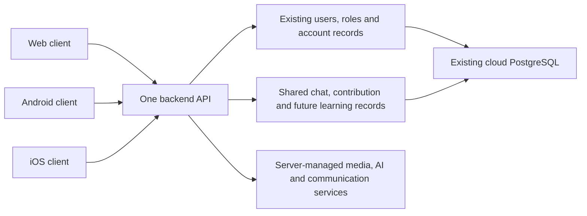

# One Luo Heritage system, separate platform projects

> Identity update, 14 October 2026: the shared coordinator now has origin-bound OS-protected persistence, renewal rotation/replay handling and offline sign-out retry. Android Keystore and iOS Keychain adapters are implemented. See [the session increment](PHASE_TWO_NATIVE_SESSION_RENEWAL.md) and delivery plan; earlier memory-only statements below are historical. Complete device acceptance and the remaining shared features are still required.

Confirmed 12 October 2026: web, Android and iOS share the same backend, existing cloud database, user identities, roles and centrally stored history. The institution's future JOOUST migration changes the central service location, not the identity of each person's account.

## Actual folder structure

```text
src/app/                         Existing Next.js web screens and backend APIs
src/components/shared/           React screens used by web and mobile
src/components/layout/           Web adapters and reusable sidebar controls
src/lib/app-*.ts                 Shared public data contracts/navigation/client
src/lib/account-contract.ts      Shared account/chat-history data contracts
src/lib/account-data.ts          Server-only account/history queries
prisma/                          One central data model and migration history
clients/mobile/src/              Shared Android/iOS UI entry and mobile adapters
clients/mobile/android/          Android project, OS resources and settings
clients/mobile/ios/              iOS project, OS resources and settings
clients/mobile/scripts/doctor.mjs Build-environment checks
```

The Android and iOS folders are now generated. They contain their platform configuration and native integration; the shared React screens are maintained once. The existing web project stays in its current location so its routes/build/deployment continue to work.

## How accounts and history work



- A person uses the existing user ID on every platform. There is no separate Android/iOS user database and no copying/recreating current accounts.
- Personal history is read/written on the backend using the authenticated user's ID. Client-supplied IDs cannot select another person's history. Shared chat-history reads are now implemented; cross-device lesson/progress/bookmark synchronization still requires its models/workflows.
- Each device has its own revocable session. Sharing an account does not mean copying a browser cookie or distributing a master token to phones.
- Account permissions are enforced on the server. The current account API refreshes profile/role information from the existing active user record and omits credentials.
- Public configuration/library and personal account/history APIs remain distinct. The existing web session and a new system-browser/PKCE native sign-in bridge can authorize the protected account/history APIs. Device tokens remain in memory for this proof; OS-protected persistence/refresh and actual native-device acceptance remain to be completed. See [native sign-in scope](PHASE_TWO_NATIVE_SIGN_IN.md).
- Offline storage will be a controlled local cache/pending-action queue, not a second authoritative account database. Synchronization, withdrawal handling and offline rights remain future development.

## Credential ownership

Database connections, provider secret keys and service credentials remain on the backend or secure build system. Clients call the same services through the backend. Mobile VITE_* configuration contains only public settings such as the backend origin.

Apple/Google platform identifiers, signing keys, push configuration and OAuth client registrations can differ by platform even though users and service records are shared. Use institution-owned configuration and callbacks; do not embed database, Cloudinary, AI or email secrets in the app bundle.

## Maintenance workflow

1. Change a shared screen/contract/business rule once in its shared source.
2. Run root tests/type checks and the mobile bundle check.
3. Run `npm --prefix clients/mobile run native:sync` to build once and copy the same assets into both native projects. Platform-specific sync commands are also provided.
4. Keep native permissions, signing, plugins and platform code in the respective Android/iOS directory.
5. Run native compilation and device tests with Android tools/macOS-Xcode before describing a native release as working.

Copied bundles, native build caches, local SDK paths and private signing files are ignored by Git. Native source projects and their reviewed resource/configuration changes belong in version control. The web deployment excludes the mobile project and research reference archives.

`npm --prefix clients/mobile run assets:native` exports launcher/splash artwork from the same original SVG used by the web. `npm --prefix clients/mobile run doctor` checks local prerequisites and public backend reachability without modifying accounts or records. Use `-- --platform=android`, `ios` or `web` to check one target. Missing prerequisites are reported as PENDING; a successful asset sync is not APK/IPA compilation.

## Current implementation and next work

Done in this increment: separate Android/iOS source projects, shared bundle synchronization, matching native brand assets, a reusable typed API client, a protected account profile API, and shared chat-history queries used by both the web chatbot and versioned API. The existing database schema/content is unchanged.

Pending: native device validation, persistent session/refresh integration, encrypted device storage, complete shared screen/role parity, native media/push, offline packs/sync, learning/personal progress, full PRD/NRF work and release signing. A system-browser sign-in bridge and shared account/history screen are now implemented as a development proof. Development/native projects still use the provisional `org.jooust.luoheritage.dev` identifier, not a confirmed store identity. Default localhost backend configuration is for the browser preview; native sign-in/distribution needs a reachable HTTPS backend with the new APIs deployed.

This organization follows [Capacitor's development workflow](https://capacitorjs.com/docs/basics/workflow): one web bundle is synchronized to separate native projects. See [the completion checklist](PHASE_STATUS_AND_COMPLETION_CHECKLIST.md) and [delivery plan](PHASE_TWO_DELIVERY_PLAN.md) for the full remaining scope.

Verification for this increment: sixty tests passed; root/mobile type/build checks and native asset synchronization passed; all eighteen copied bundle assets match in both native folders. Live read-only checks for two existing accounts confirmed identical web/versioned saved-chat history and anonymous rejection. Mobile-browser checks passed after using the shared client. Android/iOS compilation/signing and native account login remain pending.
